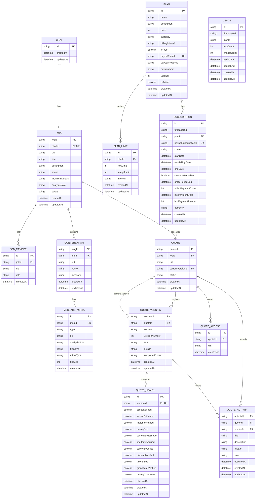

# Database Documentation

## Job, Conversation, Quotation & Subscription Management System

**Database:** PostgreSQL  
**ORM:** Prisma  
**Authentication:** Firebase Authentication  
**Document Type:** Database Design & Technical Reference

---

# 1. Overview

## 1.1 Purpose

This document describes the database architecture and data model for the application.

The database supports five major functional areas:

1. Subscription and plan management.
2. Job and project management.
3. Chat and conversation management.
4. Quotation generation and version management.
5. Quotation validation, access control and activity tracking.

The system uses PostgreSQL as its relational database and Prisma ORM for database access and schema management.

Firebase Authentication is used for user authentication. Firebase UIDs are stored as string identifiers in PostgreSQL.

## 1.2 Technology Stack

| Component                  | Technology                    |
| -------------------------- | ----------------------------- |
| Database                   | PostgreSQL                    |
| ORM                        | Prisma                        |
| Authentication             | Firebase Authentication       |
| Primary identifiers        | CUID                          |
| Media storage              | External file storage         |
| AI processing              | Application-level AI services |
| Data format for quotations | Markdown                      |

## 1.3 Database Design Principles

The database follows these principles:

- Relational data modelling.
- Referential integrity through foreign keys.
- Separation of business entities.
- Historical quotation version preservation.
- Independent job and quotation lifecycles.
- Application-level authorization.
- Transactional consistency for multi-record operations.
- Indexing for frequently accessed data.

---

# 2. Database Modules

The database is divided into the following modules.

| Module                  | Primary Responsibility                    |
| ----------------------- | ----------------------------------------- |
| Subscription Management | Plans, limits, subscriptions and usage    |
| Job Management          | Creation and management of work requests  |
| Chat Management         | Chat containers associated with jobs      |
| Conversation Management | Individual messages and their attachments |
| Quote Management        | Creation and management of quotations     |
| Quote Versioning        | Historical quotation versions             |
| Quote Access            | Managing quotation visibility             |
| Quote Health            | Completeness and calculation validation   |
| Quote Activity          | Tracking quotation-related actions        |
| Job Collaboration       | Managing users participating in jobs      |

---

# 3. Entity Documentation

## 3.1 Subscription Management

### Plan

**Purpose:** Stores available subscription plans.

| Field             | Type             | Description                                                          |
| ----------------- | ---------------- | -------------------------------------------------------------------- |
| id                | String (PK)      | Unique plan identifier                                               |
| name              | String           | Plan name                                                            |
| description       | String?          | Plan description                                                     |
| price             | Int              | Plan price in the configured currency's smallest unit, if applicable |
| currency          | String           | Currency code                                                        |
| billing_interval  | String?          | Billing interval, such as MONTH or YEAR                              |
| isFree            | Boolean          | Whether the plan is free                                             |
| paypal_plan_id    | String? (Unique) | PayPal plan identifier                                               |
| paypal_product_id | String?          | PayPal product identifier                                            |
| environment       | String           | PayPal environment, sandbox or live                                  |
| version           | Int              | Plan version                                                         |
| isActive          | Boolean          | Whether the plan is available                                        |
| createdAt         | DateTime         | Creation timestamp                                                   |
| updatedAt         | DateTime         | Last modification timestamp                                          |

**Relationships:**

- One Plan can have multiple PlanLimit records.
- One Plan can have multiple Subscriptions.

**Indexes:**

- `(environment, isActive)`

### PlanLimit

**Purpose:** Defines usage limits for individual plans.

| Field       | Type        | Description                   |
| ----------- | ----------- | ----------------------------- |
| id          | String (PK) | Unique limit identifier       |
| plan_id     | String (FK) | Associated plan               |
| text_limit  | Int         | Allowed text usage            |
| image_limit | Int         | Allowed image usage           |
| interval    | String      | Usage interval, WEEK or MONTH |
| createdAt   | DateTime    | Creation timestamp            |
| updatedAt   | DateTime    | Last modification timestamp   |

**Constraints:**

- Unique combination of `plan_id` and `interval`.

### Subscription

**Purpose:** Stores user subscription information and payment lifecycle details.

| Field                  | Type               | Description                       |
| ---------------------- | ------------------ | --------------------------------- |
| id                     | String (PK)        | Unique subscription identifier    |
| firebase_uid           | String             | Firebase user identifier          |
| plan_id                | String (FK)        | Associated plan                   |
| paypal_subscription_id | String? (Unique)   | PayPal subscription identifier    |
| status                 | SubscriptionStatus | Current subscription status       |
| start_date             | DateTime?          | Subscription start date           |
| next_billing_date      | DateTime?          | Next billing date                 |
| end_date               | DateTime?          | Subscription end date             |
| cancel_at_period_end   | Boolean            | Whether cancellation is scheduled |
| grace_period_end       | DateTime?          | Grace period expiration           |
| failed_payment_count   | Int                | Number of failed payments         |
| last_payment_date      | DateTime?          | Last successful payment date      |
| last_payment_amount    | Int?               | Last payment amount               |
| currency               | String?            | Payment currency                  |
| createdAt              | DateTime           | Creation timestamp                |
| updatedAt              | DateTime           | Last modification timestamp       |

**Subscription statuses:**

- ACTIVE
- PAST_DUE
- CANCELLED
- EXPIRED
- SUSPENDED
- APPROVAL_PENDING
- INACTIVE

**Indexes:**

- `(firebase_uid, status)`
- `(firebase_uid, end_date)`
- `(status)`
- `(next_billing_date)`

### Usage

**Purpose:** Tracks user consumption against subscription plan limits.

| Field        | Type        | Description                 |
| ------------ | ----------- | --------------------------- |
| id           | String (PK) | Unique usage record         |
| firebase_uid | String      | Firebase user identifier    |
| plan_id      | String      | Associated plan identifier  |
| text_count   | Int         | Text usage count            |
| image_count  | Int         | Image usage count           |
| period_start | DateTime    | Usage period start          |
| period_end   | DateTime    | Usage period end            |
| createdAt    | DateTime    | Creation timestamp          |
| updatedAt    | DateTime    | Last modification timestamp |

**Constraints:**

- Unique combination of `firebase_uid`, `plan_id` and `period_start`.

---

## 3.2 Job Management

### Job

**Purpose:** Represents a project or work request created by a user.

Examples:

- Bathroom renovation.
- Kitchen remodelling.
- Electrical installation.
- Plumbing work.

| Field            | Type                | Description                               |
| ---------------- | ------------------- | ----------------------------------------- |
| id               | String (PK)         | Unique job identifier                     |
| uid              | String              | Firebase UID of job owner                 |
| chatId           | String (FK, Unique) | Associated chat                           |
| title            | String              | Short job title                           |
| description      | String (Text)       | Brief job description                     |
| scope            | String (Text)       | Detailed work scope and deliverables      |
| technicalDetails | String? (Text)      | Technical specifications and requirements |
| analysisNote     | String? (Text)      | AI-generated job analysis                 |
| status           | JobStatus           | Current job lifecycle status              |
| createdAt        | DateTime            | Creation timestamp                        |
| updatedAt        | DateTime            | Last modification timestamp               |

**Job statuses:**

- DRAFT
- SENT
- APPROVED
- ACCEPTED

**Relationships:**

- One Job has one Chat.
- One Job has multiple Conversation messages.
- One Job can have multiple Quotes.
- One Job can have multiple JobMembers.

**Indexes:**

- `(uid, status)`
- `(uid, updatedAt)`

### JobMember

**Purpose:** Stores users participating in a job.

| Field     | Type          | Description                   |
| --------- | ------------- | ----------------------------- |
| id        | String (PK)   | Membership identifier         |
| jobId     | String (FK)   | Associated job                |
| uid       | String        | Firebase UID of member        |
| role      | JobMemberRole | Member role                   |
| createdAt | DateTime      | Membership creation timestamp |

**Member roles:**

- OWNER
- CUSTOMER
- TRADIE
- COLLABORATOR

**Constraints:**

- Unique combination of `jobId` and `uid`.

---

## 3.3 Chat Management

### Chat

**Purpose:** Represents the conversation container associated with a job.

| Field     | Type        | Description                 |
| --------- | ----------- | --------------------------- |
| id        | String (PK) | Unique chat identifier      |
| createdAt | DateTime    | Creation timestamp          |
| updatedAt | DateTime    | Last modification timestamp |

**Relationships:**

- One Chat belongs to one Job.
- One Job references one Chat.

**Constraint:**

- `Job.chatId` is unique, enforcing one chat per job.

---

## 3.4 Conversation Management

### Conversation

**Purpose:** Stores individual messages exchanged during job discussions.

| Field     | Type          | Description                        |
| --------- | ------------- | ---------------------------------- |
| msgId     | String (PK)   | Globally unique message identifier |
| jobId     | String (FK)   | Associated job                     |
| uid       | String?       | Firebase UID of message author     |
| author    | MessageAuthor | Message origin                     |
| message   | String (Text) | Message content                    |
| createdAt | DateTime      | Message creation timestamp         |
| updatedAt | DateTime      | Last modification timestamp        |

**Message authors:**

| Author | Description                         |
| ------ | ----------------------------------- |
| AI     | AI-generated messages and responses |
| USER   | Messages generated by end users     |
| SYSTEM | Application-generated notifications |

**Relationships:**

- One Job has multiple messages.
- One Conversation message can have multiple MessageMedia records.

**Indexes:**

- `(jobId, createdAt)`
- `(uid)`

### MessageMedia

**Purpose:** Stores media attachments associated with conversation messages.

| Field        | Type           | Description                 |
| ------------ | -------------- | --------------------------- |
| id           | String (PK)    | Unique media identifier     |
| msgId        | String (FK)    | Associated message          |
| type         | MediaType      | Media category              |
| url          | String (Text)  | External media URL          |
| analysisNote | String? (Text) | AI-generated media analysis |
| fileName     | String?        | Original file name          |
| mimeType     | String?        | MIME type                   |
| fileSize     | Int?           | File size in bytes          |
| createdAt    | DateTime       | Creation timestamp          |
| updatedAt    | DateTime       | Last modification timestamp |

**Media types:**

- IMAGE
- VIDEO
- DOCUMENT
- AUDIO

**Business rules:**

- Multiple attachments can belong to one message.
- Each attachment belongs to one message.
- Media files are stored externally.
- Database records contain file URLs and metadata.
- Each media attachment can have an independent AI analysis note.

---

## 3.5 Quote Management

### Quote

**Purpose:** Represents a quotation generated for a particular job.

| Field            | Type        | Description                           |
| ---------------- | ----------- | ------------------------------------- |
| quoteId          | String (PK) | Globally unique quote identifier      |
| jobId            | String (FK) | Associated job                        |
| uid              | String      | Firebase UID of quote creator         |
| status           | QuoteStatus | Current quote lifecycle status        |
| currentVersionId | String?     | Reference to currently active version |
| createdAt        | DateTime    | Creation timestamp                    |
| updatedAt        | DateTime    | Last modification timestamp           |

**Quote statuses:**

- DRAFT
- READY
- SENT
- VIEWED
- APPROVED
- REJECTED
- EXPIRED

**Relationships:**

- One Job can have multiple Quotes.
- One Quote can have multiple QuoteVersions.
- One Quote can have multiple QuoteAccess records.
- One Quote can have multiple QuoteActivity records.
- One Quote can reference one current QuoteVersion.

**Important constraint:**

The current version relationship uses a composite foreign key:

`(quoteId, currentVersionId)` references `(quoteId, versionId)` in QuoteVersion.

This guarantees that a quote cannot reference a version belonging to another quote.

### QuoteVersion

**Purpose:** Stores individual historical versions of a quotation.

| Field            | Type           | Description                           |
| ---------------- | -------------- | ------------------------------------- |
| versionId        | String (PK)    | Globally unique version identifier    |
| quoteId          | String (FK)    | Parent quote                          |
| version          | String         | Human-readable version, e.g. v1, v1.1 |
| versionNumber    | Int            | Numeric version ordering              |
| title            | String         | Quote title                           |
| details          | String (Text)  | Complete quotation in Markdown        |
| supportedContext | String? (Text) | AI-generated supporting context       |
| createdAt        | DateTime       | Version creation timestamp            |
| updatedAt        | DateTime       | Last modification timestamp           |

**Relationships:**

- Every version belongs to one Quote.
- Every version can have one QuoteHealth record.
- Every version can have multiple QuoteActivity records.

**Constraints:**

- Unique `(quoteId, version)`.
- Unique `(quoteId, versionNumber)`.
- Unique `(quoteId, versionId)` for the composite foreign key.

**Versioning rules:**

1. Historical versions must not be overwritten.
2. Every saved revision creates a new version.
3. Restoring an older version creates another version containing the restored content.
4. The current version pointer is updated when a new version becomes active.

---

## 3.6 Quote Access Management

### QuoteAccess

**Purpose:** Controls which users are authorized to access a quotation.

| Field     | Type        | Description                     |
| --------- | ----------- | ------------------------------- |
| id        | String (PK) | Unique access identifier        |
| quoteId   | String (FK) | Associated quote                |
| uid       | String      | Firebase UID of authorized user |
| createdAt | DateTime    | Access creation timestamp       |

**Constraints:**

- Unique `(quoteId, uid)`.

**Business rules:**

- Multiple users can access one quote.
- One user can access multiple quotes.
- Access applies to the logical quote and its versions.
- Authorization must be enforced server-side.

---

## 3.7 Quote Health Management

### QuoteHealth

**Purpose:** Evaluates quotation completeness and calculation accuracy.

Each quote version can have one health assessment.

#### Completeness checks

| Field           | Type     | Validation                            |
| --------------- | -------- | ------------------------------------- |
| scopeDefined    | Boolean? | Scope and deliverables are specified  |
| labourEstimated | Boolean? | Labour costs are included             |
| materialsAdded  | Boolean? | Materials and quantities are included |
| pricingSet      | Boolean? | Pricing information is available      |
| customerMessage | Boolean? | Customer-facing message is provided   |

#### Accuracy checks

| Field              | Type     | Validation                       |
| ------------------ | -------- | -------------------------------- |
| lineItemsVerified  | Boolean? | Quantity × unit price is correct |
| subtotalVerified   | Boolean? | Line items sum matches subtotal  |
| discountVerified   | Boolean? | Discount calculation is correct  |
| taxVerified        | Boolean? | Tax calculation is correct       |
| grandTotalVerified | Boolean? | Final amount is correct          |
| pricingConsistent  | Boolean? | No missing or conflicting prices |

#### Metadata

| Field     | Type                | Description                 |
| --------- | ------------------- | --------------------------- |
| id        | String (PK)         | Unique health record        |
| versionId | String (FK, Unique) | Associated quote version    |
| checkedAt | DateTime?           | Latest validation timestamp |
| createdAt | DateTime            | Creation timestamp          |
| updatedAt | DateTime            | Last modification timestamp |

**Validation states:**

| Value | Meaning           |
| ----- | ----------------- |
| true  | Validation passed |
| false | Validation failed |
| null  | Not checked       |

**Business rules:**

- Health assessments belong to individual versions.
- Completeness and accuracy are independent assessments.
- Validation should run automatically wherever possible.
- Scores should be calculated from individual checks.
- Nullable Boolean values distinguish unchecked fields from failed checks.

---

## 3.8 Quote Activity Management

### QuoteActivity

**Purpose:** Maintains a historical record of quotation-related activities.

| Field       | Type              | Description                         |
| ----------- | ----------------- | ----------------------------------- |
| activityId  | String (PK)       | Globally unique activity identifier |
| quoteId     | String (FK)       | Associated quote                    |
| versionId   | String (FK)       | Associated quote version            |
| title       | String            | Short activity title                |
| description | String? (Text)    | Activity description                |
| initiator   | ActivityInitiator | Activity initiator                  |
| icon        | String            | Lucide React icon name              |
| occurredAt  | DateTime          | Actual activity occurrence time     |
| createdAt   | DateTime          | Record creation timestamp           |
| updatedAt   | DateTime          | Last modification timestamp         |

**Initiators:**

- AI
- USER

**Example activities:**

| Activity         | Initiator | Icon         |
| ---------------- | --------- | ------------ |
| Quote created    | AI        | file-plus    |
| Labour updated   | USER      | pencil       |
| Materials added  | USER      | package-plus |
| Pricing verified | AI        | calculator   |
| Quote restored   | USER      | history      |

**Business rules:**

- Activities belong to a quotation and a specific version.
- Activities should be append-only.
- Historical activities should not be overwritten.
- `occurredAt` and `createdAt` represent different timestamps.

---

# 4. Entity Relationship Overview

## 4.1 Main relationships

| Parent       | Child                | Relationship        |
| ------------ | -------------------- | ------------------- |
| Plan         | PlanLimit            | One-to-many         |
| Plan         | Subscription         | One-to-many         |
| Chat         | Job                  | One-to-one          |
| Job          | Conversation         | One-to-many         |
| Job          | Quote                | One-to-many         |
| Job          | JobMember            | One-to-many         |
| Conversation | MessageMedia         | One-to-many         |
| Quote        | QuoteVersion         | One-to-many         |
| Quote        | QuoteAccess          | One-to-many         |
| Quote        | QuoteActivity        | One-to-many         |
| Quote        | Current QuoteVersion | Optional one-to-one |
| QuoteVersion | QuoteHealth          | Optional one-to-one |
| QuoteVersion | QuoteActivity        | One-to-many         |

## 4.2 Relationship diagram



---

# 5. Primary Keys and Foreign Keys

## 5.1 Primary Keys

Every entity has a unique primary identifier.

Most identifiers use Prisma's `cuid()` generator.

| Entity        | Primary Key |
| ------------- | ----------- |
| Plan          | id          |
| PlanLimit     | id          |
| Subscription  | id          |
| Usage         | id          |
| Chat          | id          |
| Job           | id          |
| JobMember     | id          |
| Conversation  | msgId       |
| MessageMedia  | id          |
| Quote         | quoteId     |
| QuoteVersion  | versionId   |
| QuoteAccess   | id          |
| QuoteHealth   | id          |
| QuoteActivity | activityId  |

## 5.2 Foreign Keys

| Entity        | Foreign Key                | References                                    |
| ------------- | -------------------------- | --------------------------------------------- |
| PlanLimit     | plan_id                    | Plan.id                                       |
| Subscription  | plan_id                    | Plan.id                                       |
| Job           | chatId                     | Chat.id                                       |
| JobMember     | jobId                      | Job.id                                        |
| Conversation  | jobId                      | Job.id                                        |
| MessageMedia  | msgId                      | Conversation.msgId                            |
| Quote         | jobId                      | Job.id                                        |
| Quote         | quoteId + currentVersionId | QuoteVersion.quoteId + QuoteVersion.versionId |
| QuoteVersion  | quoteId                    | Quote.quoteId                                 |
| QuoteAccess   | quoteId                    | Quote.quoteId                                 |
| QuoteHealth   | versionId                  | QuoteVersion.versionId                        |
| QuoteActivity | quoteId                    | Quote.quoteId                                 |
| QuoteActivity | versionId                  | QuoteVersion.versionId                        |

Firebase UIDs are external identifiers and are not foreign keys in the current database design.

---

# 6. Indexing Strategy

Indexes are defined to optimize frequently executed queries.

| Entity        | Indexed Fields         | Purpose                               |
| ------------- | ---------------------- | ------------------------------------- |
| Plan          | environment, isActive  | Find active plans by environment      |
| Subscription  | firebase_uid, status   | Retrieve user subscriptions           |
| Subscription  | next_billing_date      | Find upcoming billing events          |
| Usage         | firebase_uid           | Retrieve user usage                   |
| Job           | uid, status            | Filter jobs by owner and status       |
| Job           | uid, updatedAt         | Retrieve recently updated jobs        |
| JobMember     | uid                    | Find jobs associated with a user      |
| Conversation  | jobId, createdAt       | Retrieve chronological messages       |
| MessageMedia  | msgId                  | Retrieve message attachments          |
| Quote         | jobId                  | Retrieve quotations for a job         |
| Quote         | uid                    | Retrieve quotations created by a user |
| Quote         | status                 | Filter quotations by lifecycle status |
| QuoteVersion  | quoteId, createdAt     | Retrieve historical versions          |
| QuoteVersion  | quoteId, versionNumber | Version ordering and lookup           |
| QuoteAccess   | uid                    | Find quotations accessible to a user  |
| QuoteActivity | quoteId, occurredAt    | Retrieve quote activity history       |
| QuoteActivity | versionId, occurredAt  | Retrieve version-specific activity    |

Unique constraints also create database indexes where supported by PostgreSQL.

---

# 7. Data Lifecycle and Business Workflows

## 7.1 Job Creation

1. User creates a new job.
2. A Chat record is created.
3. A Job record references that Chat.
4. User starts sending messages.
5. Conversation records are created against the Job.
6. Media attachments are saved as MessageMedia records.

## 7.2 Conversation Processing

1. User submits a message.
2. The application stores the user message.
3. AI processes the message and relevant attachments.
4. AI generates a response.
5. The response is stored as an AI Conversation record.
6. If media is involved, analysis is saved against the relevant MessageMedia records.
7. System notifications are stored using the SYSTEM author.

## 7.3 Quote Generation

1. AI gathers job details and conversation context.
2. A new Quote record is created.
3. The first QuoteVersion is generated.
4. QuoteHealth is initialized.
5. Initial QuoteActivity is created.
6. The Quote's currentVersionId is updated to reference the first version.

These operations should be executed transactionally where they involve multiple database writes.

## 7.4 Quote Modification

1. User requests a quotation modification.
2. Existing quote version is retrieved.
3. AI or user generates updated quotation content.
4. A new QuoteVersion is created.
5. QuoteHealth is recalculated.
6. QuoteActivity records the modification.
7. Quote.currentVersionId is updated to the new version.

Previous versions remain unchanged.

## 7.5 Quote Restoration

1. User selects a historical version.
2. The selected version's content is retrieved.
3. A new version is created using the restored content.
4. The new version receives a new version identifier and version number.
5. QuoteHealth is recalculated.
6. QuoteActivity records the restoration.
7. Quote.currentVersionId is updated.

## 7.6 Quote Validation

1. The quotation version is evaluated.
2. Completeness checks are executed.
3. Accuracy checks are executed.
4. Results are saved in QuoteHealth.
5. The application calculates completeness and accuracy scores.
6. Users are shown failed or unchecked validation items.

---

# 8. Data Integrity and Security

## 8.1 Referential Integrity

Foreign keys maintain relationships between entities.

Important deletion rules:

- Deleting a Job cascades to its conversations, members and quotations.
- Deleting a Conversation cascades to its media records.
- Deleting a Quote cascades to its versions, access records and activities.
- Deleting a QuoteVersion cascades to its health record and associated activities.
- A currently referenced QuoteVersion cannot be deleted because its relationship uses `onDelete: Restrict`.

## 8.2 Authentication and Authorization

Firebase Authentication handles user authentication.

The application must validate the Firebase token before accessing protected resources.

Authorization must be checked for:

- Job ownership.
- Job membership.
- Conversation access.
- Quote ownership.
- Quote access permissions.
- Subscription ownership.

A valid Firebase UID alone does not establish authorization to access a particular job or quotation.

## 8.3 Data Consistency

Use Prisma transactions for operations that involve multiple related records.

Recommended transactional operations:

- Creating a job and its chat.
- Creating a quote and its initial version.
- Creating a quote version and updating the current version pointer.
- Restoring an earlier quote version.
- Updating quote health and recording validation activity.

---

# 9. Database Constraints and Limitations

The following constraints are important to understand.

1. `Job.chatId` is unique, enforcing one chat per job.
2. `QuoteVersion` enforces unique version names and numbers within a quote.
3. `QuoteAccess` prevents duplicate access records for the same user and quote.
4. `QuoteHealth.versionId` allows only one health record per version.
5. The composite foreign key guarantees that the active version belongs to its quote.
6. Firebase UID relationships are not enforced by PostgreSQL.
7. `QuoteActivity` references both Quote and QuoteVersion independently. Application logic must ensure that the referenced version belongs to the referenced quote.
8. `currentVersionId` is nullable because a quote can exist before its first version is generated.
9. Prisma's `@updatedAt` updates timestamps through Prisma operations; direct SQL updates must handle timestamps separately.

---

# 10. Future Database Enhancements

The current design provides the foundation for the MVP. The following additions can be introduced when the relevant features are implemented.

| Enhancement           | Purpose                                      | Priority |
| --------------------- | -------------------------------------------- | -------- |
| QuoteLineItem         | Store individual work items and pricing      | High     |
| QuoteRevisionMetadata | Store version change summaries               | Medium   |
| JobStatusHistory      | Maintain job status transitions              | Medium   |
| MessageMetadata       | Store token usage and AI generation metadata | Medium   |
| AIExecution           | Track AI processing operations               | Medium   |
| PaymentHistory        | Store detailed payment transactions          | High     |
| SubscriptionEvent     | Maintain payment provider webhook history    | High     |
| QuoteValidationIssue  | Store detailed validation errors             | Medium   |
| JobInvitation         | Invite customers and tradespeople            | Medium   |

### Recommended: QuoteLineItem

For accurate pricing calculations, quotation details should eventually be represented using structured records.

Potential fields:

- id
- versionId
- description
- quantity
- unit
- unitPrice
- total
- category
- createdAt
- updatedAt

Markdown can remain the presentation format, but structured line items should be the source of truth for financial calculations.

---

# 11. Prisma Development and Migration

## 11.1 Schema Validation

Run the following commands after modifying the Prisma schema:

```bash
npx prisma format
npx prisma validate
```

## 11.2 Development Migration

```bash
npx prisma migrate dev --name init
```

## 11.3 Prisma Client Generation

```bash
npx prisma generate
```

## 11.4 Database Inspection

```bash
npx prisma studio
```

## 11.5 Production Migration

For production deployments:

```bash
npx prisma migrate deploy
```

Production deployments should use reviewed migrations rather than `prisma db push`.

---

# 12. Conclusion

The database architecture separates subscription management, job management, conversation handling and quotation management into independent but interconnected modules.

The design supports:

- Multiple jobs per user.
- One conversation container per job.
- Multiple messages and media attachments.
- Multiple quotations per job.
- Historical quotation versioning.
- Active quotation version tracking.
- Quote completeness and accuracy assessments.
- Multi-user quotation access.
- Quotation activity tracking.
- Future job collaboration.

The architecture is designed to support the MVP while allowing additional functionality to be introduced incrementally without requiring major changes to the existing data model.

**Document status:** Database design reference for implementation and future maintenance.
